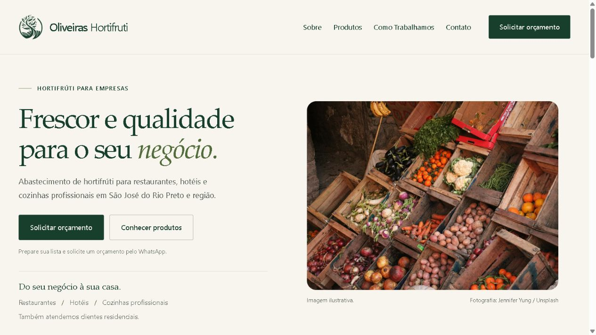

# Oliveiras Hortifruti — Portfolio Edition

A responsive institutional website for a fresh produce distributor in São José do Rio Preto, Brazil. The project presents the business, its family history, product categories, and a practical WhatsApp quotation journey for business and residential customers.

[Live commercial website](https://oliveirashortifruti.com.br)

This is a standalone portfolio edition prepared from the website source, without its private Git history, client documents, internal reports, deployment archives, or production operations tooling. Website copy is in Brazilian Portuguese; code and documentation are in English.

## Screenshots

### Desktop



### Mobile


Screenshots are captured from the local portfolio build, without customer data.

## Tech stack

- Next.js 16 App Router and React 19
- TypeScript with strict checking
- CSS Modules and shared CSS design tokens
- Static HTML/CSS/JavaScript export
- ESLint and the Node.js test runner

## Key features

- Mobile-first header, navigation, and editorial Hero.
- Family-history section distinguishing experience since 1990 from the current company phase.
- Four produce categories with locally optimized, licensed WebP photography.
- Three-step ordering explanation and accessible quotation form.
- Local form validation and safely encoded WhatsApp message preparation, without a submission database or backend.
- Privacy page, semantic landmarks, skip link, visible focus states, descriptive image alternatives, and responsive layouts.
- Canonical and Open Graph metadata, robots.txt, sitemap.xml, and an exported error page.

The visual system combines forest green, olive, cream, restrained gold, serif headlines, and generous spacing. The site has no ecommerce checkout, payment processing, customer accounts, or stock-management features.

## Run locally

Use Node.js **24.x** (see `.nvmrc`) and npm. From the project directory:

```sh
npm ci
npm run dev
```

Open `http://localhost:3000`. No environment file, API key, database, or external service account is required.

```sh
npm run lint
npm run typecheck
npm run test:quotation
npm run build
npm start
```

`npm run build` generates the static website in `out/`. `npm start` previews only that output at `http://127.0.0.1:4173`; stop with Ctrl+C. Do not use `next start` with a static export.

The six quotation tests cover required fields, customer types, length limits, Unicode and reserved-character encoding, inert user-supplied markup, and malformed UTF-16. The existing Node module-type warning during tests is non-failing.

## Portfolio behavior and boundaries

This edition always emits **noindex, nofollow** and retains canonical URLs pointing to the commercial website. Its local preview also sends a blocking robots header. These choices affect only this copy and do not change the live website or its approved production indexing. The sitemap and policy describe the original site; this repository is not a deployment template for another business.

The publicly advertised business name, regional location, official WhatsApp number, and domain are retained intentionally. The quotation button can open the real business WhatsApp with a prepared message. Use synthetic data for demonstrations and do not confirm sending test messages. No message is transmitted to the company automatically. Host/platform processing is distinct from application-side storage.

The Privacy Policy is reproduced as public website content, not legal guidance or a template. No client identifiers, operating practices, performance metrics, or claims have been added for the portfolio.

## Structure

```text
src/
  app/                       # Homepage, document, metadata routes, privacy page
  components/layout/         # Header and footer
  components/sections/       # Hero, About, Products, process, Contact
  content/                   # Typed product-category content
  lib/                       # Quotation validation/encoding and site metadata
public/                      # Optimized official logo and six local photographs
scripts/preview-static.mjs   # Loopback-only static preview
tests/                      # Quotation regression tests
docs/
  image-credits.md
  screenshots/
```

## Assets and rights

See [image credits](docs/image-credits.md) for photo sources, authors, and licenses. Stock photography is illustrative and does not depict the company's actual facilities, staff, or inventory.

The Oliveiras Hortifruti name, official logo, and business content belong to their respective rights holders. No blanket open-source license or permission to reuse the branding is granted by this portfolio edition. Third-party photographs remain governed by their own licenses. Public portfolio publication has been authorized by the project owner; this does not grant permission to reuse the branding.

Publishing this source repository does not deploy a separate portfolio website or modify the commercial website, hosting, or production indexing.
